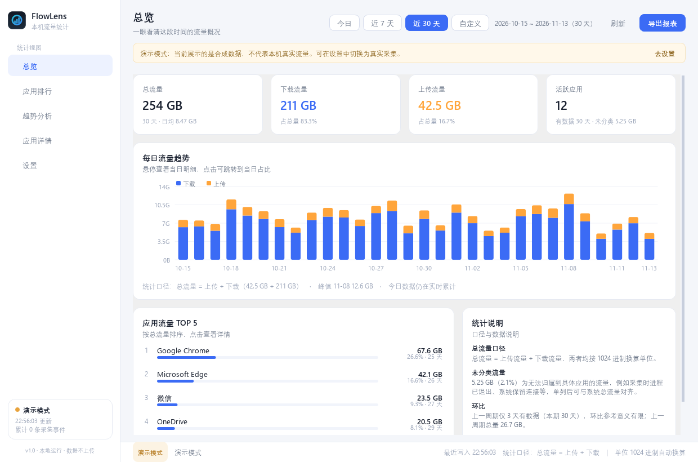
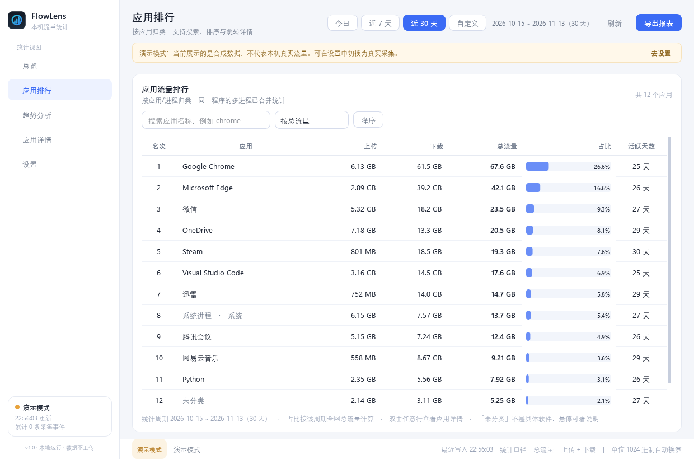
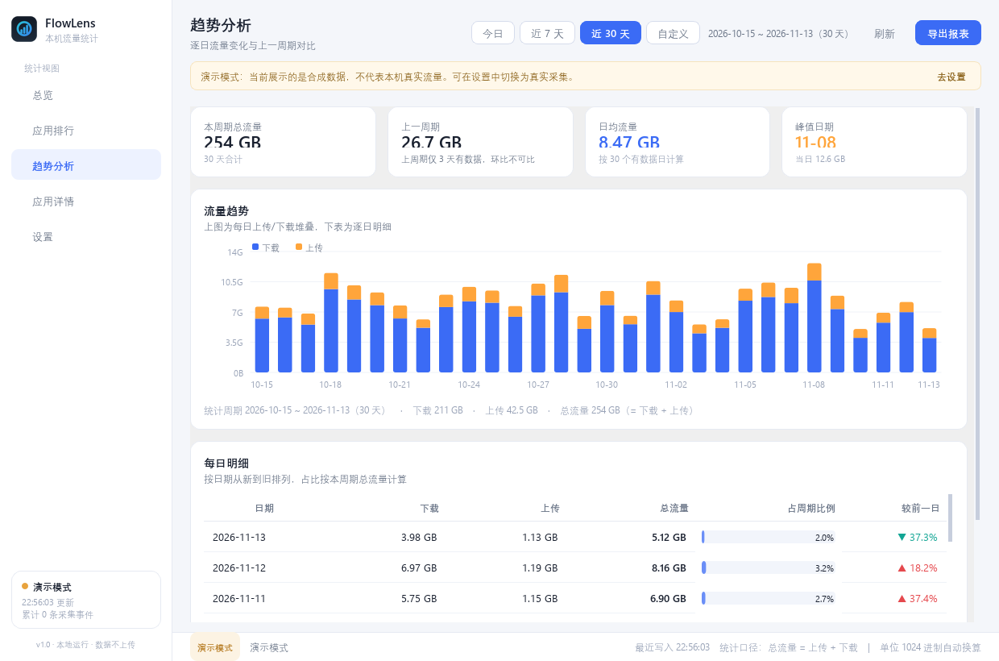
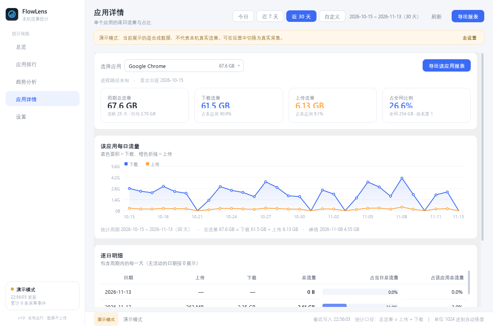
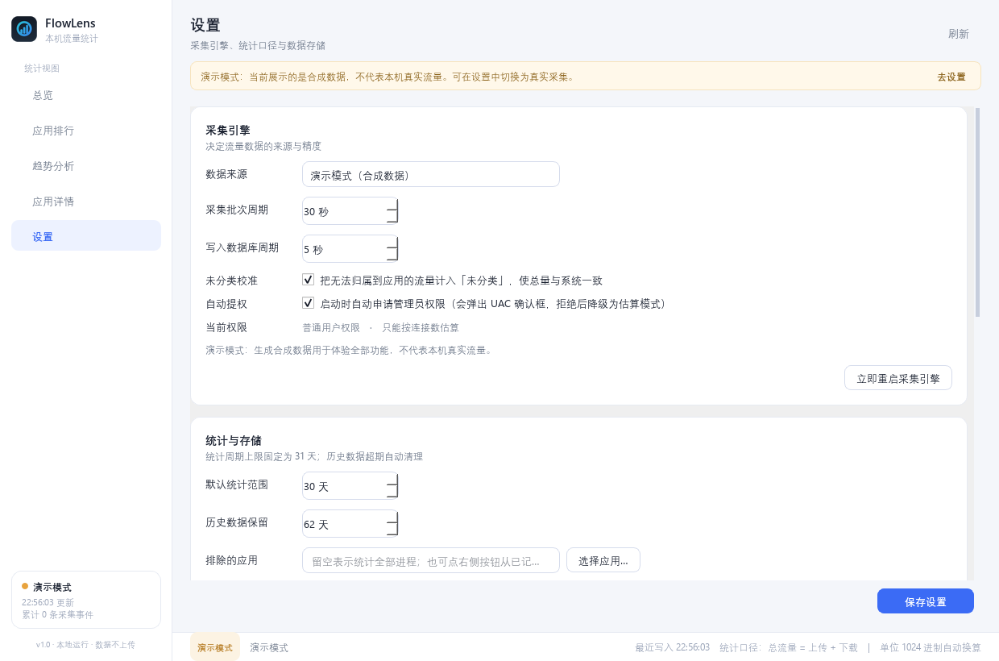
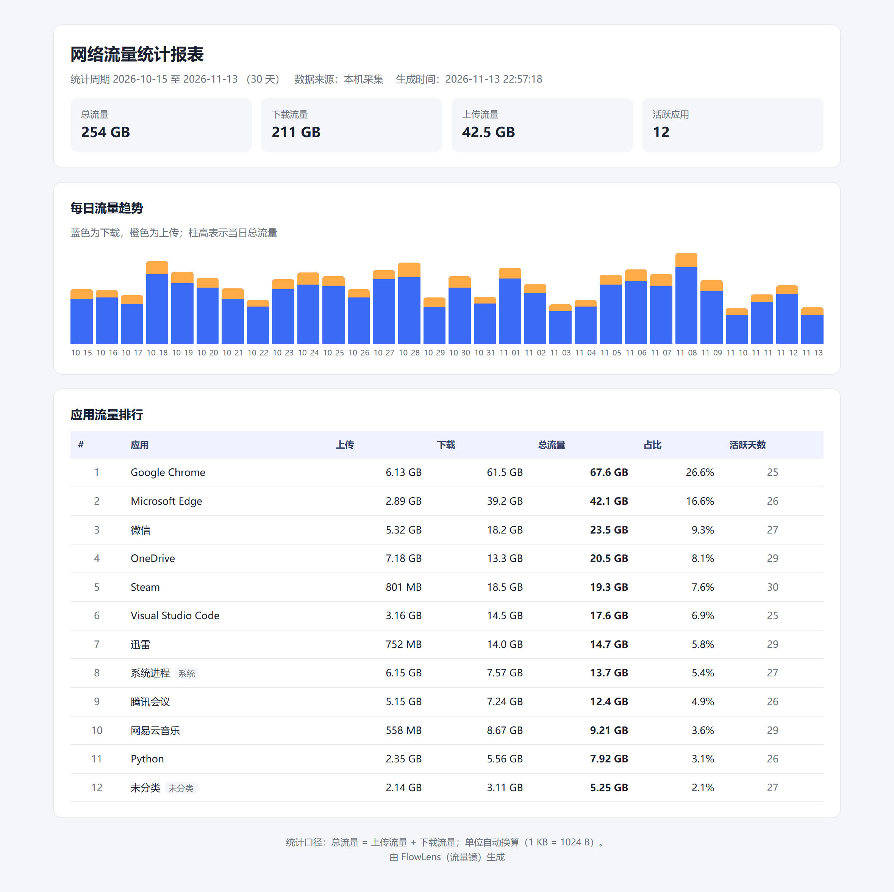

# FlowLens · 流量镜 · 本机网络流量统计

一款运行在本机的桌面软件，**持续监视并统计各个有网络活动的应用/进程的流量使用情况**。
默认统计最近 30 天，支持选择任意起止日期（最长 31 天），按应用归类记录上传、下载与总流量，
提供总览、应用排行、趋势分析、应用详情四个视图，并支持导出通用报表。

> 统计口径：**总流量 = 上传流量 + 下载流量**；单位按 1024 进制自动换算（B / KB / MB / GB / TB）。

---

## 0. 界面预览

| 总览 | 应用排行 |
| --- | --- |
|  |  |

| 趋势分析 | 应用详情 |
| --- | --- |
|  |  |

| 设置 | 导出的 HTML 报表 |
| --- | --- |
|  |  |

> 截图为演示模式（合成数据）下的完整界面，便于一次看清所有功能；
> 真实运行时只有状态标签不同（会显示「精确采集」或「估算」）。

---

## 关于名字与图标

**FlowLens = Flow（流量）+ Lens（镜片）**，中文名 **流量镜**：
像一面镜子，把本机每一份流量照清楚——哪个应用在用、用了多少、什么时候用得最多。

图标是「发光圆环 + 三根递升的数据柱」：圆环对应 Lens（镜片/取景器），
三根柱子是流量柱状图，青→蓝的渐变与界面里的下载/上传配色同源。

| 文件 | 用途 |
| --- | --- |
| `src/assets/icon-raw.png` | 设计稿原件（1024×1024，带白底与水印） |
| `src/assets/icon-1024.png` | 处理后的透明圆角图（去水印、裁边），文档与品牌展示用 |
| `src/assets/app.ico` | 程序图标（16/24/32/48/64/128/256 七档，exe 与窗口/托盘共用） |

`src/tools/make_icon.py` 负责后两步：`--prepare` 处理设计稿，不带参数则生成 ico。
16~32px 那几档是单独重绘的简化图形（去掉柔光、线条加粗），否则缩到托盘尺寸会糊成一团。

---

## 1. 快速开始

### 方式一：下载 exe（推荐，无需安装 Python）

到 [Releases](../../releases) 页面下载最新版 `FlowLens.exe`（约 45 MB），放到任意文件夹双击即可运行，不需要装 Python。

> 仓库里只放源码，exe 作为 Release 附件单独发布（二进制不进版本库）。
> 想单独分发时，只拷这一个 exe 到任意文件夹也能正常跑——`data/` 与 `logs/`
> 会跟着 exe 走，生成在 exe 所在目录。

- 首次启动会在 exe 同目录生成 `data/`（配置 + 数据库）与 `logs/`（运行日志）；
  删掉这两个目录再启动 = 恢复出厂设置。
- 这两个目录默认带「隐藏」属性，资源管理器里不显示，免得和程序文件混在一起；
  想看就打开「文件夹选项 → 显示隐藏的文件」，或直接用设置页的
  「打开数据目录 / 打开日志目录」按钮。
- 源码模式（`python src/run.py`）的数据落在 `src/data`、`src/logs`，与 exe 的历史数据
  互不干扰——调试时可以随便造数据，不怕写脏正式库。
- **不需要右键「以管理员身份运行」**：程序启动时会自己申请管理员权限，
  在 UAC 弹窗点「是」即可拿到逐连接的精确统计（详见第 5 节）。
  点「否」也能正常使用，只是统计变成估算，界面顶部会提示并可一键重试。
- 首次运行若弹出 Windows 的「已保护你的电脑」→ 点「更多信息」→「仍要运行」
  （exe 未做代码签名，属正常现象）。
- 单文件模式每次启动要先解压运行时，开机后第一次打开约 2~5 秒；
  想要秒开可改打目录版：`python src/build_exe.py --onedir`。

### 方式二：从源码运行

> 主目录已有 `FlowLens.exe` 时，双击 `src/run.bat` 会直接启动它，跳过下面这套
> Python 检测 —— 想强制走源码，带上任意参数（如 `run.bat --demo`）即可。

#### Windows：直接双击 `src/run.bat`

脚本会自己找到可用的 Python（`py -3` → PATH 里的 `python` → 常见安装目录），
自动跳过微软商店那个「假 python」占位程序，首次运行还会自动装好依赖，
然后以无控制台方式启动主窗口。

启动正常时不会有黑窗口残留；如果窗口没出现：

| 现象 | 处理 |
| --- | --- |
| 提示「未找到可用的 Python」 | 装个 Python 3.9+（勾选 Add python.exe to PATH），或编辑 `src/run.bat` 把 `set "PY=C:\Python313\python.exe"` 那行取消注释并填上真实路径 |
| 窗口一闪而过 / 打不开 | 双击 `src/run-debug.bat`，它会保留控制台并打印 `src/logs/app.log`，能看到具体错误 |
| 想看后台发生了什么 | 打开 `src/logs/app.log`（自动轮转，最多 3 份备份） |

### 命令行启动（任意平台）

```bash
python -m pip install PySide6 psutil openpyxl   # 依赖
python src/run.py                               # 正常启动
python src/run.py --demo                        # 演示模式（合成数据，看全部功能）
python src/run.py --mode etw                    # 强制精确模式（会自动申请管理员权限）
python src/run.py --no-elevate                  # 不提权，直接用估算模式
python src/run.py --tray                        # 不显示窗口，直接驻留托盘（开机自启动用）
```

启动时会自动申请管理员权限（UAC 弹窗点「是」）；源码模式下若不想提权，加 `--no-elevate`。

首次启动会在**程序目录**（exe 所在目录）下创建 `data/` 与 `logs/`；源码模式则在 `src/` 下：

```
data/
├── config.json      # 配置（采集模式、保留天数、界面尺寸等）
├── traffic.db       # SQLite 数据库（统计结果，重启不丢失）
└── exports/         # 导出的报表默认位置
logs/
└── app.log          # 启动过程与异常记录
```

---

## 2. 功能对照

| 需求 | 实现 |
| --- | --- |
| 持续监视各应用流量 | 采集引擎常驻后台线程，按批次采集 → 缓冲聚合 → 每 5 秒落库 |
| 默认最近 30 天 / 任意起止最多 31 天 | 顶部「今日 / 近 7 天 / 近 30 天 / 自定义」，自定义支持日历选择并做合法性校验 |
| 按应用/进程自动归类 | PID → 进程名 → 应用键（同一程序多进程合并），常见应用映射为友好名称 |
| 分别记录上传、下载、总流量 | 数据表按「应用 × 自然日」分别累计 `upload_bytes` / `download_bytes` |
| 总览界面 | KPI 卡（总/上传/下载/活跃应用）+ 每日堆叠柱状图 + TOP6 + 统计说明 |
| 应用排行 | 表格排行，支持名称搜索、5 种排序字段、升降序切换、占比条、双击进详情 |
| 趋势变化 | 每日堆叠趋势图 + 与上一等长周期的环比 + 逐日明细表（含较前一日变化） |
| 单个应用详情 | 逐日上传/下载/总流量 + 占当日总流量比例 + 占该应用总流量比例 + 双折线图 |
| 按日期和应用名称搜索筛选 | 日期由全局周期控制；名称搜索在排行页与详情页下拉框中均支持 |
| 按流量大小排序 | 总流量 / 上传 / 下载 / 日均，升序降序皆可 |
| 导出通用报表 | CSV（UTF-8 BOM，Excel 直开不乱码）、XLSX（多工作表）、HTML（可打印为 PDF） |
| 历史数据保留、重启不丢 | SQLite 持久化，按日累加写入；退出前强制 flush；保留期外自动清理 |
| 关闭窗口不误伤统计 | 关闭时弹窗二选一：「留在后台继续统计」或「直接关闭」；托盘常驻，可随时恢复、刷新、退出 |
| 开机自启动 | 写 `HKCU\...\Run` 启动项（无需管理员），登录 Windows 后自动以托盘模式开始统计；设置页可一键开关 |
| 单位自动换算 | `format_bytes()` 统一处理，图表坐标轴用紧凑写法 |
| 明确统计口径 | 状态栏、总览说明卡、报表页脚三处显式标注 |

---

## 3. 界面结构

```
┌──────────────┬─────────────────────────────────────────────────────────────┐
│  FlowLens    │  总览 / 应用排行 / 趋势分析 / 应用详情 / 设置              │
│  ├ 总览      │  ─────────────────────────────────────────────────────────  │
│  ├ 应用排行  │  KPI 卡片 · 图表 · 表格（占据主区域，随周期与筛选联动）     │
│  ├ 趋势分析  │                                                             │
│  ├ 应用详情  │                                                             │
│  └ 设置      │                                                             │
│              │                                                             │
│  ● 采集状态  ├─────────────────────────────────────────────────────────────┤
└──────────────┴─────────────────────────────────────────────────────────────┘
```

- **顶部工具条**：统计周期一键切换「今日 / 近 7 天 / 近 30 天 / 自定义」，右侧实时显示当前区间与天数。
- **总览**：总流量 / 下载 / 上传 / 活跃应用四张 KPI 卡；每日流量堆叠柱状图（悬停显示当日明细）；
  TOP6 应用（点击直达详情）；统计说明（口径、未分类流量、环比、数据来源）。
- **应用排行**：支持输入应用名实时筛选，切换排序字段与升降序；占比列带进度条；双击进入详情；
  「未分类」行整行可悬停，气泡说明它为什么不是一个具体软件。
- **趋势分析**：本期 / 上期 / 日均 / 峰值四张 KPI 卡；趋势图；逐日明细（含「较前一日」涨跌）。
- **应用详情**：「选择应用」是一个可搜索可点选的选择器——点击展开带总流量的应用列表，
  或直接在字段上敲字即时筛选；↑↓ 移动、Enter 确认、Esc 关闭；周期总量、下载、上传、占全网比例；
  双折线图；逐日明细含两种占比。
- **设置**：采集模式与周期、未分类校准、默认统计范围、保留天数、排除应用（点「选择应用…」从已记录的
  应用里勾选，也支持手动填进程名）、关闭窗口行为、数据目录（含「打开数据目录 / 打开日志目录」按钮）、
  临时文件清理、清空数据、统计口径说明。

### 3.1 关闭窗口：退出还是留在后台

点窗口右上角的关闭按钮会先问一句，避免「想放后台却把统计关掉」：

| 选择 | 结果 |
| --- | --- |
| 留在后台继续统计 | 窗口收起、任务栏不再占位，采集线程照常运行，数据不断档；托盘图标可双击恢复，右键可刷新 / 退出 |
| 直接关闭 | 结束进程并停止统计，已写入数据库的数据不丢失（退出前会强制 flush） |
| 点对话框右上角 ✕ / Esc | 什么都不做，继续使用 |

- 勾选「记住我的选择」后写入 `config.json` 的 `close_action`，也可在设置页「窗口与托盘 → 关闭窗口时」随时改回「每次询问」。
- 托盘不可用（如资源管理器崩溃）时自动退化为直接关闭，不会出现「窗口藏了但找不到」的情况。
- 程序已经在后台时再双击 exe，会通过本地 socket 把已有窗口唤到前台（而不是弹一句「已经在运行」）。

### 3.2 开机自启动

设置页「窗口与托盘 → 开机自启动」，**勾上就生效，不需要再点保存**（取消勾选同样立即删除）。
本质是往当前用户的启动项里写一条：

```
HKCU\Software\Microsoft\Windows\CurrentVersion\Run
  FlowLens = "…\FlowLens.exe" --tray
```

- 登录 Windows 后**直接驻留托盘**开始统计，不弹主窗口、不打扰桌面；双击托盘图标即可查看。
- 属于「当前用户」级启动项，**不需要管理员权限**；可在「任务管理器 → 启动应用」里查看或禁用。
- 取消勾选（或删掉该项）立即失效，不留残余；exe 换目录后启动时会自动把旧路径校正为新路径。
- 数据目录不是默认位置时会一并写进命令（`--tray --data-dir "…"`），保证统计的仍是同一份数据。

### 3.3 文件位置与临时文件清理

所有数据都在程序目录下，属于便携式布局（不往 `%APPDATA%` 写任何东西）：

| 文件 | 位置 | 说明 |
| --- | --- | --- |
| 数据库 | `data/traffic.db`（含 `-wal` / `-shm`） | 应用表与按日流量，删掉即清空历史 |
| 配置 | `data/config.json` | 全部设置项 |
| 日志 | `logs/app.log` | 采集模式切换、提权结果、异常栈 |
| 采集临时文件 | `%TEMP%\netusage_etw_*` | logman/tracerpt 中转的 `.etl` / `.xml` |

ETW 采集期间，每批数据会先在临时目录里中转，正常停止时采集器会自己删掉。但如果程序被任务管理器强杀、
或采集线程初始化中途异常，目录会留下空壳。因此：

- 默认在**启动时自动扫一遍**（设置页「统计与存储 → 临时文件」可关闭），只删除名字以
  `netusage_etw_` 开头、且 **1 小时内没有改动** 的目录；正在采集的目录每 30 秒就有新写入，
  不会被误删。`%TEMP%` 下其它任何内容都不碰。
- 提权进程创建的目录，普通权限删不掉（Windows ACL 所致），程序会记录「因权限不足未能删除」，
  这属于正常现象，重新以管理员身份运行程序后再清理即可。
- 设置页该行会显示当前残留的数量与体积，旁边的「立即清理」按钮可随时手动清一次
  （执行时会跳过采集器正在使用的那个目录）。普通权限运行时读不到提权进程目录里的文件，
  体积会显示为「需管理员权限才能统计」，实际可能不小——这些残留里往往还留着 `.etl` 数据。

### 3.4 排除不想统计的应用

设置 → 统计与存储 → 排除的应用 → **选择应用…**，会打开一个可勾选的窗口：

- 列表来源是数据库里**记录过的全部应用**（含系统进程），按历史累计流量降序——先看到的就是流量大户；
  每行显示「应用名 · 进程名 · 累计流量」，系统进程带灰色标签。
- **点行的任意位置即可勾选**，不必精确点中那个小方框；底部实时显示「已勾选 N 个」。
- 搜索框按**应用名或进程名**过滤（输入 `steam` 能同时匹配 Steam 与 steamwebhelper.exe）；
  「全选 / 清空」只作用于**当前筛选结果**，不会误伤其它应用。
- 列表里没有的进程可以手动添加：填 `thunder.exe` 这类进程名（不带 `.exe` 会自动补上），
  添加后立即勾选并置顶。名称需与任务管理器「详细信息」里一致。
- 保存后**立即生效**：写库时按进程名跳过这些应用，上传和下载都不再记录。
  已经存在的历史数据不会删除；取消勾选即可恢复统计。
- 排除按**进程名**匹配，所以同一程序的多个进程（如浏览器的子进程）会一起去掉。

输入框里仍可直接编辑逗号分隔的进程名，鼠标悬停可看完整排除清单。


---

## 4. 模块结构

```
FlowLens/
├── FlowLens.exe                  # 打包好的单文件 exe（双击即用）
├── README.md                     # 本说明文档
├── data/                         # 运行数据：config.json + traffic.db + exports/（已设为隐藏）
├── logs/                         # 运行日志 app.log，自动轮转（已设为隐藏）
└── src/                          # ← 源码全部收在这里；删掉它也不影响 exe 运行
    ├── build_exe.py              # 打包脚本（产物输出到上一层的 FlowLens.exe）
    ├── run.py                    # 源码运行入口
    ├── run.bat                   # 双击启动：优先用 exe，找不到 exe 才走 Python
    ├── run-debug.bat             # 保留控制台并打印日志，排查启动问题用
    ├── requirements.txt
    ├── assets/
    │   ├── icon-raw.png          # 图标设计稿原件（1024×1024）
    │   ├── icon-1024.png         # 处理后的透明圆角图（文档/品牌展示）
    │   └── app.ico               # exe 与窗口/托盘图标（七档尺寸）
    ├── docs/                     # README 引用的界面截图
    ├── tools/
    │   ├── make_icon.py          # 处理设计稿并生成 ico（--prepare 先跑一次）
    │   ├── shots.py              # 用演示数据重生成 docs/ 里的界面截图
    │   └── _selftest_autostart.py  # 开机自启动回归自检（16 项断言）
    └── app/
        ├── main.py                   # 主程序：参数解析、依赖组装、启动窗口、日志/单实例
        ├── core/                     # 配置与通用模型
        │   ├── config.py             # 必要配置内容（默认值、读写、校验、程序目录解析）
        │   ├── winadmin.py           # 管理员权限判断与 UAC 自动提权重启
        │   ├── instance.py           # 单实例锁（共享内存 + 本地 socket，兼做窗口唤醒）
        │   ├── autostart.py          # 开机自启动（HKCU Run 项读写与路径校正）
        │   ├── tempclean.py          # 清理 %TEMP% 下残留的 ETW 采集目录
        │   ├── models.py             # 视图数据模型
        │   ├── daterange.py          # 统计周期与边界处理（最长 31 天）
        │   ├── appnames.py           # 进程名 → 应用身份/友好名
        │   └── units.py              # 字节单位自动换算
        ├── storage/                  # 数据存储模块
        │   ├── database.py           # SQLite 建表、UPSERT 累加写入、清理
        │   └── repository.py         # 只读聚合查询（应用维度 / 日期维度）
        ├── collector/                # 采集模块
        │   ├── base.py               # 采集器抽象与事件模型
        │   ├── etw.py                # Windows ETW 精确采集（logman + tracerpt）
        │   ├── estimate.py           # 估算模式（无需管理员权限）
        │   ├── simulator.py          # 演示模式（合成数据）
        │   └── service.py            # 采集服务：线程、缓冲、定时落库、降级策略
        ├── stats/                    # 统计与报表模块
        │   ├── aggregator.py         # 总览/排行/趋势/详情聚合（占比、环比、排名）
        │   └── exporter.py           # CSV / XLSX / HTML 报表导出
        └── ui/                       # 界面模块
            ├── main_window.py        # 主窗口：侧边栏、头部、页面栈、状态栏
            ├── theme.py              # 浅色主题样式表
            ├── charts.py             # 自绘柱状图/折线图（无第三方图表依赖）
            ├── widgets.py            # 卡片、KPI、徽章、空状态、占比条委托
            ├── app_picker.py         # 应用选择器（搜索 + 列表点选 + 键盘操作）
            ├── dialogs.py            # 周期选择、关闭方式选择、确认对话框
            ├── exclude_dialog.py     # 排除应用选择窗口（勾选 + 搜索 + 手动添加）
            └── pages/                # 总览 / 排行 / 趋势 / 详情 / 设置
```

---

## 4.1 管理员权限：自动提权

ETW 精确采集必须有管理员权限。程序不再要求你右键运行，而是启动时自己处理：

```
双击 exe
   ↓
已是管理员？ ──是──→ 直接走 ETW 精确模式
   │否
   ├─→ 设置里关了「自动提权」，或选了演示/估算模式 ──→ 直接运行（估算模式）
   └─→ 调用 ShellExecuteW("runas") 重新拉起自己 → 弹 UAC
            ├─ 点「是」→ 新实例以管理员身份启动，原实例退出 → ETW 精确模式
            └─ 点「否」→ 原实例继续运行 → 估算模式 + 提示条可一键重试
```

实现要点：

- **顺序**：提权发生在「申请单实例锁」之前。因为新实例启动时也要拿同一把锁，
  若先占锁就会被自己拦住；界面上的「以管理员身份重启」按钮同理——先 `release_single_instance()` 再拉起。
- **防死循环**：新实例命令行自动追加 `--no-elevate`，不会互相拉起。
- **失败可退**：UAC 返回 `ERROR_CANCELLED(1223)` 或任意错误码时，程序照样启动，
  只在提示条说明精度差异，不会出现「点了没反应」。
- **可关闭**：设置 → 采集引擎 → 「自动提权」取消勾选后，启动不再弹 UAC。
- **命令行**：`--no-elevate` 可单次跳过提权（调试或批处理时用）。

---

## 5. 数据来源与精度

程序按优先级自动选择采集方式，失败会**自动降级而不是崩溃**：

| 模式 | 说明 | 权限 | 精度 |
| --- | --- | --- | --- |
| **ETW 精确模式** | 订阅 Windows 内核事件 `Microsoft-Windows-Kernel-Network`，逐连接拿到「进程 PID + 字节数」，与系统「资源监视器」同源 | 需管理员（启动时自动申请） | 逐连接精确 |
| **估算模式** | 用 `psutil` 读取系统总收发字节（精确），再按各进程的活动连接数分摊 | 无需 | 总量精确、分配估算 |
| **演示模式** | 生成带日间波动、周末回落、随机空档的合成数据 | 无需 | 仅用于体验/评审 |

ETW 模式的实现不依赖任何原生扩展：用系统自带的 `logman` 启动 ETW 会话、`tracerpt` 导出为
带字段名的 XML，再解析归属到 PID。只统计 TCP/UDP 的**数据收发**事件，重传（RETRANSMIT）与
拷贝（COPY）事件不计入，避免同一份字节被重复累计。

当前模式在界面左下角、底部状态栏明确标识，非精确模式还会在顶部显示提示条。

---

## 6. 统计口径与边界处理

| 情况 | 处理方式 |
| --- | --- |
| **统计周期边界** | 结束日期自动收敛到今天；超过 31 天会在选择时提示并拒绝；跨零点的采集批次按事件时间分别归入对应自然日 |
| **无网络活动** | 不写入任何记录；界面显示「所选周期内没有网络活动」空状态，图表绘制占位文案，不出现除零错误 |
| **应用无法识别** | 进程已退出 / 无法读取名称 / 系统保留流量 → 统一计入 **未分类**（`__unclassified__`），单独成行展示 |
| **数据缺失** | 趋势与详情按「所选周期的每一天」补 0 展示，曲线连续、日期不缺格；详情表对 0 值显示「—」 |
| **权限不足** | 启动时自动申请管理员权限；用户拒绝或系统策略禁止 → 记录原因并降级为估算模式，提示条给出「以管理员身份重启」按钮，程序不退出 |
| **采集中断/异常退出** | 缓冲每 5 秒落库，最多损失一个批次；ETW 会话残留会在下次启动时自动清理 |
| **数据库损坏** | 自动备份为 `traffic.corrupt-*.db` 并重建空库，保证程序可启动 |
| **总量对齐** | ETW 模式下用系统累计收发字节校准差额，差额（≥3%）计入未分类，保证「各应用之和 ≈ 系统总流量」 |
| **历史保留** | 默认保留 62 天（可在设置中调整 31~730 天），每小时检查一次并清理超期数据，孤立应用记录一并回收 |

---

## 7. 报表导出

导出入口有两处：顶部「导出报表」（整份报表）与详情页「导出该应用报表」（附带该应用逐日明细）。

- **CSV**：UTF-8 带 BOM，分段包含「汇总 / 应用排行 / 每日趋势 /（可选）应用详情」，字段同时给出字节原始值与可读值。
- **XLSX**：4 个工作表（总览、应用排行、每日趋势、应用详情），表头着色、占比列使用百分比格式、冻结首行。
- **HTML**：单文件网页报表，自带样式与柱状图，可直接打印成 PDF 分享。

---

## 8. 配置项（`data/config.json`）

| 键 | 默认 | 说明 |
| --- | --- | --- |
| `collector_mode` | `auto` | `auto` / `etw` / `estimate` / `demo` |
| `collect_interval` | `30` | 采集批次周期（秒） |
| `flush_interval` | `5` | 写入数据库周期（秒） |
| `reconcile_unclassified` | `true` | 用系统总流量校准未分类 |
| `auto_elevate` | `true` | 启动时自动申请管理员权限（关掉后不再弹 UAC，固定估算模式） |
| `excluded_apps` | `[]` | 不参与统计的进程名（小写） |
| `default_range_days` | `30` | 默认统计范围（天） |
| `max_range_days` | `31` | 统计周期上限（天） |
| `retention_days` | `62` | 历史数据保留天数 |
| `auto_clean_temp` | `true` | 启动时清理 `%TEMP%\netusage_etw_*` 下残留的采集临时目录 |
| `restore_last_range` | `true` | 启动时恢复上次的统计周期 |
| `close_action` | `ask` | 关闭窗口时的行为：`ask` 每次询问 / `quit` 直接退出 / `tray` 留在后台 |
| `window_width` / `window_height` | `1240` / `820` | 窗口尺寸 |

命令行参数 `--data-dir` / `--demo` / `--mode` / `--no-elevate` 优先于配置文件；环境变量 `NETUSAGE_DATA_DIR` 可改变默认数据目录。

---

## 9. 常见问题

**Q：为什么显示「估算模式」？**
A：ETW 需要管理员权限，而这次启动没有拿到（UAC 里点了「否」，或系统策略禁止提权）。
直接点提示条右侧的「以管理员身份重启」重试即可；也可以右键 exe →「以管理员身份运行」。
如果你本来就不想弹 UAC，可在设置里关掉「自动提权」，程序会一直以估算模式运行。

**Q：数据存在哪里？会上传吗？**
A：全部保存在本机 `data/traffic.db`，程序不发起任何网络上报。

**Q：为什么某个应用显示为「未分类」？**
A：「未分类」不是一个具体软件，而是无法可靠归属到具体进程的流量集合：采集时进程已退出、
系统/驱动层收发、虚拟网卡，以及网卡总量与逐进程合计之间的校准差额都会并入这里。
在应用排行里把鼠标移到该行任意位置即可看到说明气泡；详情页会标注「多来源汇总」。
ETW 模式下这部分通常很小；若想减少，请让程序以管理员权限运行（默认会自动申请）。

**Q：换机器 / 备份数据怎么办？**
A：直接复制整个 `data/` 目录即可，数据库与配置都在其中。

**Q：主目录里怎么只剩一个 exe 了？`data/` 和 `logs/` 去哪了？**
A：都在，只是带了「隐藏」属性，资源管理器默认不显示，免得和程序文件混在一起。
想看它们：勾上「查看 → 显示 → 隐藏的项目」，或直接用设置页
「统计与存储 → 打开数据目录 / 打开日志目录」。

**Q：`src/` 文件夹能删吗？**
A：能删，删了 exe 照常运行——它是单文件程序，依赖与图标都已打进 exe 里。
`src/` 放的是源码（`app/`）、图标设计稿（`assets/`）、界面截图（`docs/`）和几个开发脚本；
只有想改功能、重新打包时才需要它。

**Q：为什么总量和运营商账单不一致？**
A：本工具统计的是本机网卡层面的收发字节，运营商计费还包含协议封装开销、重传等；且若多台设备共享网络，账单会更大。

**Q：点了关闭，程序是不是就不统计了？**
A：会让你选。「留在后台继续统计」只收起窗口，采集线程照常运行；选「直接关闭」才会退出进程。
想改默认行为：设置页「窗口与托盘 → 关闭窗口时」，或对话框里勾「记住我的选择」。

**Q：窗口关到托盘后找不到了怎么办？**
A：看任务栏右下角（Win11 可能收在 `^` 展开区里），双击托盘图标恢复；
也可以重新双击一次 `FlowLens.exe`，程序会自动把已经在后台的那个窗口唤到前台。

**Q：设置了开机自启动，开机后没看到窗口？**
A：这是设计如此：自启动只驻留托盘，不弹主窗口，避免每次开机都被挡一下。
点任务栏右下角的托盘图标（或 `^` 展开区里的青蓝色环形图标）即可打开完整界面。

**Q：勾了「开机自启动」，为什么过一会儿又变回没勾？**
A：旧版本的这个勾选要配合「保存设置」才写注册表，而设置页每 5 秒会重新读数刷新一次，
没保存的勾选就被冲掉了。现在已改为**勾选即写入注册表**，状态行会立刻显示「已加入 Windows
启动项」；定时刷新也只更新只读信息，不会再动你正在编辑的内容。

**Q：怎么彻底取消开机自启动？**
A：设置页取消勾选「开机自启动」即可（立即生效）；也可以在「任务管理器 → 启动应用」里把
FlowLens 设为「已禁用」，效果相同。

---

## 10. 重新打包 exe

改了代码要重新出包时（需要本机有 Python，PyInstaller 会自动安装）：

```bash
python src/build_exe.py              # 单文件 exe → 输出到 src/ 的上一层 ./FlowLens.exe
python src/build_exe.py --onedir     # 目录版，启动更快，产物为 ./FlowLens/ 整个文件夹
python src/build_exe.py --debug      # 保留控制台窗口，便于看 traceback
```

打包要点：

- 入口是 `src/run.py`，界面走 `--windowed`（无黑框），图标取自 `src/assets/app.ico`；
  中间产物（`build/`、`.build_dist/`）都留在 `src/` 内，打完自动清理，主目录只多一个 exe。
- 单文件模式下 `__file__` 位于临时解压目录，因此程序目录一律通过
  `app/core/config.py: program_dir()`（`sys.executable`）解析，保证 `data/`、`logs/`
  始终落在 exe 旁边，而不是随临时目录一起消失。
- 打包时剔除了 `tkinter` / `QtWebEngine` / `QtQml` 等未使用模块，体积从约 90 MB 降到 45 MB。
- 若同时开着源码版和 exe 版不会互相干扰：单实例锁按数据目录区分，只有指向同一份
  `traffic.db` 的第二个实例才会被拦下（否则流量会被重复累计）。
